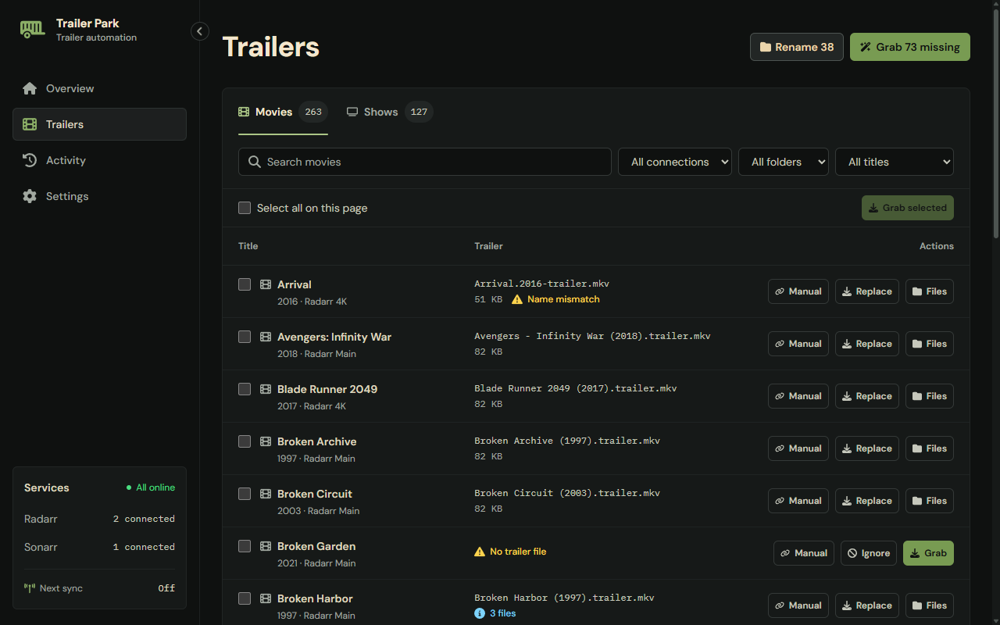
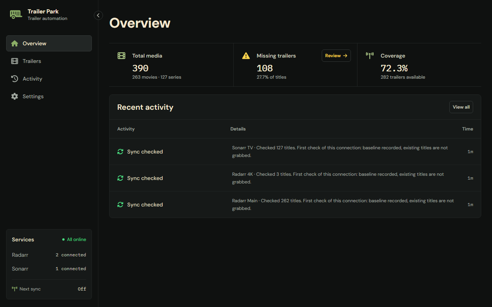
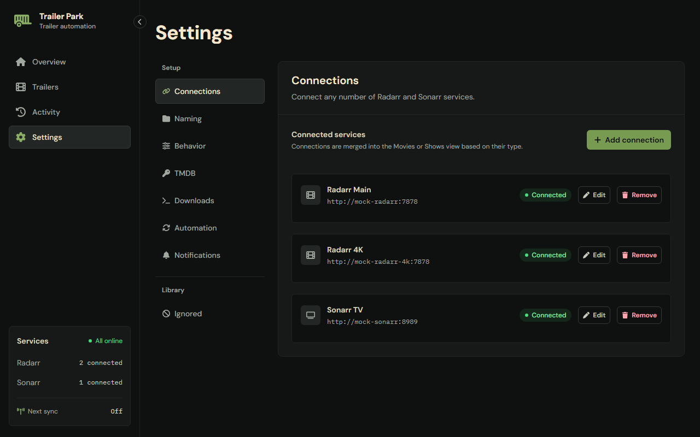

# Trailer Park

Downloads local trailers for your Radarr and Sonarr titles. It looks each title up on TMDB, picks the best trailer, downloads it from YouTube with yt-dlp, and saves it next to the media in a layout that Plex and Jellyfin pick up. Everything is managed from one web interface.

> [!IMPORTANT]
> **Built with AI.** Trailer Park is developed with heavy AI assistance. A human plans the work, reviews the changes and oversees the result, but much of the code and documentation is written by AI. If something looks wrong, please open an issue.

Current release: **v0.11.0** <!-- x-release-please-version -->

[Changelog](CHANGELOG.md) · [Contributing](CONTRIBUTING.md) · [Security](SECURITY.md) · [License](LICENSE)



<details>
<summary>More screenshots</summary>





</details>

## Features

- **Radarr and Sonarr.** Connects to any number of instances. Each title appears once, under **Movies** or **Shows**.
- **Finds what is missing.** A title has a trailer whatever the file is called and wherever it sits, so existing trailers are never grabbed twice.
- **Grabs trailers your way.** One title, a hand-picked selection, every missing title at once, or automatically when new titles arrive. TMDB picks the trailer, scored by keywords you can change ([how](docs/trailer-selection.md)). Or give it a YouTube link.
- **Manages trailer files.** Replace, rename, keep one or delete. It only touches files it recognizes as trailers, never the media itself, and an old trailer is removed only after its replacement downloaded.
- **Stays visible.** Live download logs, a persistent activity log and optional Discord notifications.
- **Keeps yt-dlp current** from inside the app.

## Install

You need Docker with Compose, a free [TMDB](https://www.themoviedb.org/) account, and the API keys of your Radarr and Sonarr. Save this as `docker-compose.yml` and set your media path:

```yaml
services:
  trailer-park:
    image: ghcr.io/geebru/trailer-park:latest
    container_name: trailer-park
    volumes:
      - /path/to/media:/data/media
      - ./config:/config
    ports:
      - "8080:8080"
```

Then start it and open `http://SERVER-IP:8080`:

```bash
docker compose up -d
```

The image is published for `linux/amd64` and `linux/arm64`. Tags are `X.Y.Z`, `X.Y` and `latest` (from 1.0 also `X`). `latest` is the newest release; pin a full version tag (`X.Y.Z`) if you want to choose when to upgrade. To upgrade, run `docker compose pull` and `docker compose up -d` with the same `/config` volume (more in [Upgrading](docs/upgrading.md)).

**Media paths must match.** Trailer Park uses the folder paths your Radarr and Sonarr report, so your media has to be visible inside this container at the same path the Arrs see. If Radarr says `/data/media/movies/Dune (2021)`, mount the same media at `/data/media`. The **Media folder** setting is the top-level folder those paths must sit under (default `/data/media`). Path mapping between the Arrs and Trailer Park is not supported yet.

**Run it as a normal user.** Add `user: "UID:GID"` (for example `"1000:1000"`) with IDs that can read and write your media folders and the `/config` volume. On Unraid, `99:100` is common. The container runs as root without it, which works but is not recommended ([why](docs/security.md)). If you add `user:` to an install that already ran as root, change the owner of `./config` once, for example `sudo chown -R 1000:1000 config`.

**Host names.** Trailer Park answers requests that reach it as `localhost`, by IP address, by a single-word name such as `gaming-pc`, or by a name ending in `.local`, `.lan` or `.home.arpa`. Any other name gets a `421` that says how to allow it. That includes your own domain, a reverse proxy name and Tailscale names (`*.ts.net`). To allow one, set `ALLOWED_HOSTS` to a comma-separated list (`*.example.com` matches every subdomain) and restart:

```yaml
    environment:
      ALLOWED_HOSTS: "trailers.example.com,*.ts.net"
```

`/health` always answers, so Docker health checks work with any name.

> [!WARNING]
> Trailer Park has **no login**. Anyone who can reach its port can change settings and delete the trailers it manages. Keep it on a trusted network, or behind a VPN or an authenticating reverse proxy. See [Security](docs/security.md).

## First run

1. **Settings → TMDB:** paste your TMDB **API Read Access Token** (the long one, not the short v3 key), then press **Test key**. A successful test saves it.
2. **Settings → Connections:** press **Add connection**, choose Radarr or Sonarr, and enter a name, the base URL (for example `http://radarr:7878` or `http://sonarr:8989`) and the API key. **Test and save** checks both first.
3. **Settings → Naming:** make sure **Media folder** is the folder your libraries sit under, and check the **Output preview**.
4. Open **Trailers**, find a title in the Missing view and press **Grab**. Or press **Grab N missing** to do them all.
5. **Settings → Automation:** the default **Sync interval** is 5 minutes, so new imports are grabbed automatically from then on.

## Documentation

- [Using the app](docs/using.md): Overview, Trailers (what counts as a trailer, grabbing, batches, files) and Activity.
- [Settings](docs/settings.md): every section, automatic grabs, the files in `/config` and environment variables.
- [How a trailer is chosen](docs/trailer-selection.md): keyword scoring, fallbacks, and yt-dlp updates and cookies.
- [Command line, script and API](docs/cli-and-api.md)
- [Security](docs/security.md) and [reporting a vulnerability](SECURITY.md)
- [Upgrading](docs/upgrading.md), including from Trailarr Parrk
- [Contributing](CONTRIBUTING.md)

## License

Trailer Park is released under the [MIT License](LICENSE). Third-party material keeps its own license:

- Font Awesome Free icons (`static/ui/js/icons.js`): CC BY 4.0.
- DM Sans and IBM Plex Mono (`static/ui/fonts/`): SIL Open Font License 1.1, with the license files alongside.
- axe-core (`dev/axe/`): MPL-2.0. It is a development tool and is not part of the image.
- The Docker image also contains ffmpeg, deno, yt-dlp, Flask, Waitress and Alpine Linux packages, each under its own license.
